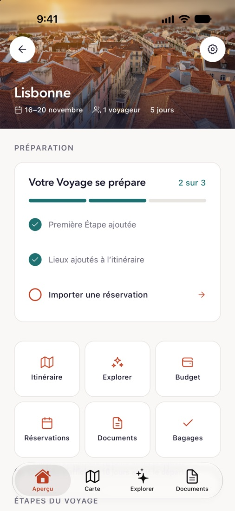
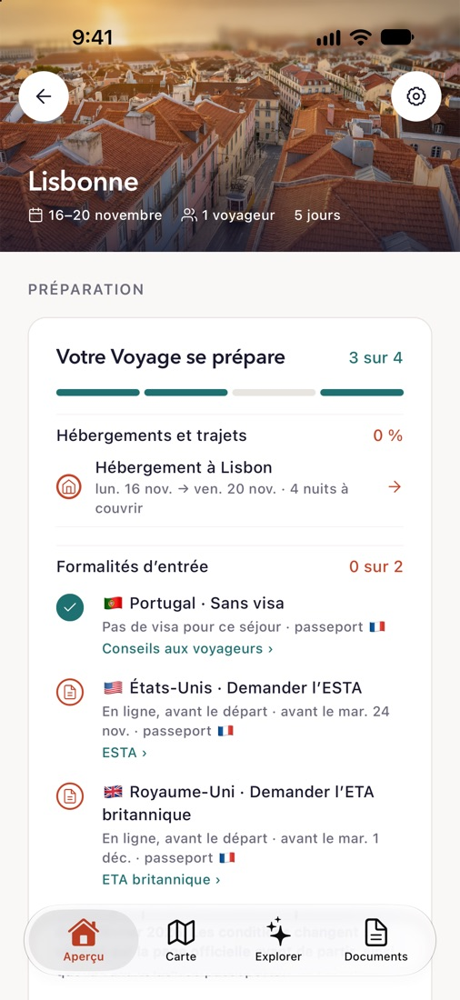
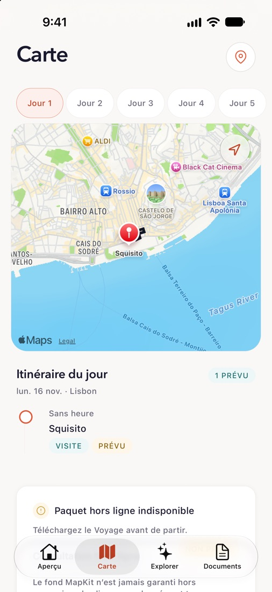
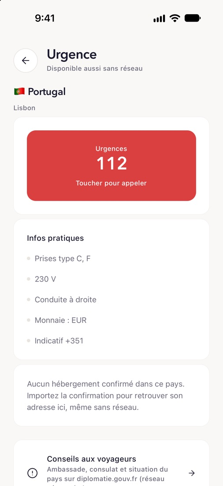

# Naveyo

**Le voyage, sans rien oublier.** Naveyo est une application iPhone qui réunit tout un voyage au même endroit et aide à le préparer : les étapes, l'itinéraire jour par jour, les lieux à découvrir, les réservations, les documents, le budget et la liste de bagages. Elle est pensée pour les couples, les familles et les groupes d'amis.

> [!WARNING]
> **Application en cours de développement.** Naveyo n'est pas publiée et n'est pas prête pour un usage réel. Certaines fonctionnalités sont incomplètes, et ce qui existe aujourd'hui est surtout validé sur le simulateur iOS.

> [!NOTE]
> **Un projet pour apprendre à construire avec l'IA.** Naveyo est avant tout un terrain d'apprentissage. L'objectif est de comprendre comment mener un vrai projet mobile de bout en bout avec des agents de code : cadrer, découper, faire coder, relire, tester et intégrer. L'IA est aussi utilisée *dans* l'application, avec des garde-fous stricts.

## Aperçu

<table>
  <tr>
    <td align="center"><br><sub>Aperçu du voyage</sub></td>
    <td align="center"><br><sub>Préparation et formalités d'entrée</sub></td>
    <td align="center"><br><sub>« Où dormez-vous ? »</sub></td>
  </tr>
  <tr>
    <td align="center"><br><sub>Carte et itinéraire du jour</sub></td>
    <td align="center"><br><sub>Explorer autour d'une étape</sub></td>
    <td align="center"><br><sub>Fiche urgence, même sans réseau</sub></td>
  </tr>
</table>

<sub>Captures du simulateur iOS avec un voyage de test à Lisbonne. Certains écrans viennent de branches de travail pas encore fusionnées dans `main`.</sub>

## Fonctionnalités

- **Voyages et étapes** : un voyage découpé en étapes (villes, dates), partagé avec ses compagnons de route par invitation.
- **Itinéraire et carte** : programme jour par jour, carte MapKit, trajets et météo de chaque étape.
- **Explorer** : lieux à proximité d'une étape (restaurants, visites…), avec photos et fiche détaillée.
- **Journée composée par l'IA** : l'assistant propose une journée complète à partir de lieux réels, que l'on valide avant de l'ajouter.
- **Import de réservations** : on partage une confirmation (PDF, capture, e-mail) vers Naveyo depuis la feuille de partage iOS. Le texte est extrait sur l'iPhone, puis analysé pour créer un brouillon de réservation à vérifier.
- **Documents** : un coffre privé pour les billets, passeports et confirmations, consultable hors ligne.
- **Budget et dépenses**, **liste de bagages partagée**.
- **Préparation** : ce qui manque au voyage (hébergement, formalités d'entrée, informations pratiques du pays, numéros d'urgence).
- **Hors ligne** : les données essentielles du voyage restent disponibles sans réseau.

## L'IA dans le workflow de développement

Ce dépôt est presque entièrement écrit avec des agents de code (Claude Code et Codex), pilotés par un humain qui tient le rôle de coordinateur et de relecteur. Le but n'est pas de « laisser l'IA coder » mais d'apprendre une méthode qui tienne sur un projet réel.

### 1. Cadrer avant de coder

Tout part de [`TASKS.md`](TASKS.md), un plan de tâches écrit et maintenu avec l'IA :

- chaque tâche a un identifiant (`ARC-001`, `GEO-004`, `AI-101`…), une priorité, une **timebox**, des dépendances, des **livrables** et des **critères d'acceptation** ;
- un **graphe de dépendances** (Mermaid) fixe l'ordre d'intégration ;
- chaque tâche **possède des chemins de fichiers** précis, pour que deux agents ne touchent jamais les mêmes fichiers ;
- les décisions d'architecture sont consignées dans des ADR ([`docs/adr`](docs/adr)), et les incertitudes techniques (GPS en arrière-plan, extension de partage iOS) sont d'abord levées par des *spikes* ([`docs/spikes`](docs/spikes)).

### 2. Des agents en parallèle, par vagues

Le travail est organisé en **vagues parallèles** de trois agents au maximum :

- un agent reçoit **une seule tâche** `READY`, travaille sur **sa propre branche** (`geo-003-…`, `rsv-001-…`) et ne modifie que les chemins qu'il possède ;
- les branches sont développées en parallèle, souvent dans des `git worktree` séparés, puis intégrées dans l'ordre du graphe ;
- chaque agent termine par un **compte rendu standardisé** (résultat, commits, validations exécutées, critères non satisfaits, risques) ;
- **un agent ne marque jamais sa propre tâche comme terminée** : c'est le coordinateur qui vérifie et change l'état.

### 3. Des garde-fous humains

- Les tâches de fondation (bootstrap, contrats du domaine, schéma Supabase) attendent un **« GO push » explicite** après présentation du diff et des validations.
- Les règles durables des agents vivent dans [`AGENTS.md`](AGENTS.md) (lu aussi par Claude Code via [`CLAUDE.md`](CLAUDE.md)).
- Les audits d'intégration de chaque vague distinguent ce qui est **prouvé** de ce qui reste à valider : une tâche reste `IN_PROGRESS` tant qu'elle n'a pas été vérifiée pour de vrai (simulateur ou iPhone).

### 4. La vérification comme filet de sécurité

Le code produit par les agents n'est accepté que s'il passe la même chaîne de vérification :

```bash
pnpm verify
```

Elle enchaîne lint, typecheck et tests Vitest, et tourne aussi en CI ([`.github/workflows/verify.yml`](.github/workflows/verify.yml)) avec `expo-doctor`. Les tests ciblent surtout la logique métier, les validateurs et les contrats des Edge Functions, là où une erreur d'agent coûte le plus cher. Le rendu est ensuite contrôlé visuellement sur le simulateur iOS, que les agents pilotent eux-mêmes pour capturer et vérifier les écrans.

### 5. L'IA au-delà du code

- **UI** : les écrans sont reproduits à partir de maquettes, avec une fiche par écran dans [`docs/ui/screens`](docs/ui/screens) et un audit de conformité.
- **Documentation** : ADR, runbooks et notes de spike sont rédigés avec les agents.
- **Communication** : les vidéos de présentation du projet sont générées à partir du code et des captures du simulateur.

## L'IA dans l'application

L'IA intervient à quelques endroits précis, avec une règle commune : **elle ne doit rien inventer et ne modifie rien sans confirmation**.

| Fonction | Ce que fait l'IA | Garde-fous |
|---|---|---|
| Suggestions autour d'une étape | Choisit et explique jusqu'à cinq lieux | Les candidats viennent d'une recherche de lieux réelle ; l'IA ne peut renvoyer que leurs identifiants |
| Journée complète | Compose un programme d'au plus huit activités en tenant compte de la météo et de ce qui est déjà prévu | Heures, durées et lieux validés côté serveur ; brouillon à confirmer avant tout ajout |
| Import de réservations | Transforme le texte d'une confirmation en réservation structurée | Le texte est extrait **sur l'iPhone** (PDFKit, Vision) ; seul le texte est envoyé ; le résultat est un brouillon à valider |

Les appels passent par des Edge Functions Supabase ([`supabase/functions`](supabase/functions)), jamais directement depuis l'app. Le fournisseur est configurable (`openai`, `ollama` ou `opencode`), avec quota quotidien et sortie structurée validée.

## Stack technique

- **App** : Expo (React Native) avec Expo Router, TypeScript, MapKit via `expo-maps`, module natif Swift pour l'analyse de documents et une Share Extension iOS.
- **Backend** : Supabase (Postgres avec RLS, Storage privé, Edge Functions en Deno).
- **Données externes** : Geoapify (géocodage, lieux), Google Places en option, Open-Meteo (météo), Unsplash (photos).
- **Architecture** : modules métier indépendants ([`src/modules`](src/modules)) branchés sur des adapters ([`src/adapters`](src/adapters)), ce qui permet de tester la logique sans dépendre des services réels.

## Lancer le projet

Prérequis : Node 22, pnpm 10, Xcode et le simulateur iOS.

```bash
pnpm install
```

```bash
cp .env.example .env
```

Renseignez ensuite l'URL et la clé Supabase dans `.env` (les clés des fournisseurs d'IA et de lieux sont des secrets des Edge Functions, pas de l'app), puis lancez l'app :

```bash
pnpm ios
```

## Structure

```text
app/                 Écrans et navigation (Expo Router)
src/modules/         Logique métier (voyages, itinéraire, réservations, dépenses…)
src/adapters/        Accès aux services (Supabase, Geoapify, MapKit, analyse de documents…)
modules/             Module natif iOS (Swift) : analyse de documents et Share Extension
plugins/             Config plugins Expo (cible native, suivi GPS, cycle de vie)
supabase/            Migrations, RLS, Edge Functions et tests
docs/                ADR, spikes, runbooks et fiches UI
TASKS.md             Plan de tâches suivi par les agents
AGENTS.md            Règles durables des agents de code
```
