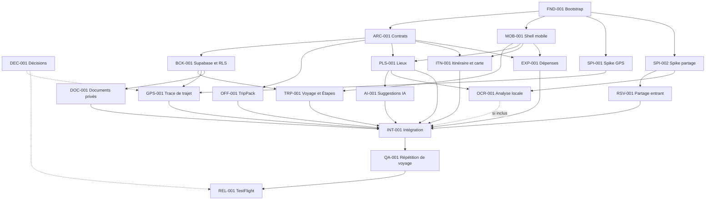

# Naveyo — plan de tâches

Date de cadrage : 28 juillet 2026.

Objectif : une alpha privée utilisable par deux adultes sur de vrais iPhone au début de septembre 2026.

## Intégration et audit de la vague 4 — 9 août 2026

- La branche `wave-4` est intégrée dans `main` par avance rapide jusqu'au commit `7440500`.
- Les livrables applicatifs de la vague 4 sont présents dans `main`. Les états restent `IN_PROGRESS` lorsque le critère restant est une validation sur iPhone réel ; cette validation sera consommée par `INT-001` puis `QA-001`.
- La vague 5 est lancée le 9 août 2026 : `INT-001` est `IN_PROGRESS`, avec les lots `INT-101` à `INT-105` distribués à des agents sur des chemins disjoints.

- `RSV-001` est `IN_PROGRESS` : Share Extension iOS, App Group, association au Voyage, persistance et centre d’imports sont intégrés. Le parsing est exclusivement confié à OpenCode Go ; l’extraction locale ne produit plus de brouillon. Il reste le test appareil complet et la validation d’une réservation réelle.
- `OCR-001` est `IN_PROGRESS` : le Module Swift extrait le texte PDF/OCR localement et transmet uniquement ce texte à l’Edge Function `document-analysis`, qui appelle OpenCode Go. Il reste la validation Xcode/iPhone et les fixtures réelles.
- `SPI-002` est `IN_PROGRESS` : la cible `NaveyoShare`, les entitlements App Group et la réception PDF/image/texte/URL sont générés. Il reste à valider les sources Mail/Fichiers/Photos sur l’iPhone.
- Les imports partagés sont persistants et idempotents côté interface : `new`, `seen`, `processing`, `failed`, `confirmed`. Un import déjà vu ne redirige plus vers l’écran à chaque démarrage ; le centre d’imports reste accessible depuis le tableau de bord.
- Correction de parsing : les champs optionnels `null` issus du pont natif sont traités comme absents. Une réponse OpenCode partiellement entourée de Markdown ou renvoyée en blocs texte est normalisée avant validation.
- Validation locale après correction : `pnpm verify` passe avec 73 tests. La validation native finale exige encore une installation et un partage réel depuis Mail/Fichiers/Photos.
- Décision utilisateur du 9 août 2026 : `DOC-001` est mis en standby. Il reste planifié mais ne bloque pas la finalisation de la vague 4 ; `INT-001`, `QA-001` et `REL-001` ne pourront toutefois pas être clôturées avec le périmètre Documents complet tant que cette tâche restera en standby.

## Mode d'emploi

- `AGENTS.md` contient les règles durables ; ce fichier contient le travail planifié.
- Le coordinateur est seul à changer les états pendant une vague parallèle.
- Un agent reçoit une seule tâche `READY` et ne modifie que ses chemins possédés.
- Les timeboxes sont des limites de travail, pas des promesses. À la fin d'une timebox, livrer ce qui est vérifié et signaler le reste.
- Une dépendance nécessaire dans `package.json`, le lockfile, `app.config.ts` ou une migration est demandée au coordinateur.
- Un agent ne marque jamais lui-même sa tâche `DONE` : il fournit son compte rendu et le coordinateur vérifie.

États possibles : `TODO`, `READY`, `IN_PROGRESS`, `BLOCKED`, `DONE`, `CUT`.

## Branches et gates de push

Chaque tâche possède sa branche. Les agents y créent de petits commits locaux vérifiés au fil de l'eau, conformément à `AGENTS.md`.

| ID | Branche |
|---|---|
| DEC-001 | `dec-001-release-decisions` |
| FND-001 | `fnd-001-bootstrap-expo` |
| ARC-001 | `arc-001-domain-contracts` |
| MOB-001 | `mob-001-mobile-shell` |
| SPI-001 | `spi-001-gps-spike` |
| SPI-002 | `spi-002-share-extension-spike` |
| BCK-001 | `bck-001-supabase-foundation` |
| TRP-001 | `trp-001-trips-stops` |
| OFF-001 | `off-001-trip-pack` |
| PLS-001 | `pls-001-places` |
| ITN-001 | `itn-001-itinerary-map` |
| AI-001 | `ai-001-trip-assistant` |
| EXP-001 | `exp-001-expenses` |
| GPS-001 | `gps-001-trip-tracking` |
| RSV-001 | `rsv-001-reservation-import` |
| DOC-001 | `doc-001-private-documents` |
| OCR-001 | `ocr-001-apple-document-analysis` |
| INT-001 | `int-001-app-integration` |
| QA-001 | `qa-001-release-qa` |
| REL-001 | `rel-001-testflight-release` |

Gates :

- `FND-001`, `ARC-001` et `BCK-001` sont des fondations : chaque push attend un `GO push` explicite de l'utilisateur après présentation des commits, du diff et des validations.
- Pour les autres tâches, le coordinateur peut autoriser le push après vérification du compte rendu.
- L'autorisation porte sur l'état exact présenté. Tout nouveau commit invalide l'autorisation et nécessite une nouvelle validation.
- Un agent peut continuer à créer des commits locaux sans push tant que son périmètre reste isolé.
- Le nom de branche est fixe. Si une tâche est reprise, continuer sur cette branche plutôt que créer un suffixe arbitraire.

## Budget et ligne de coupe

| Profil | Contenu | Timebox cumulée |
|---|---|---:|
| Alpha cœur | Voyage, offline, carte, lieux, IA, Dépenses, partage direct, documents privés et QA | ~87 h |
| Alpha GPS | Alpha cœur + spike et Trace de trajet continue | ~105 h |
| Alpha complète | Alpha GPS + extraction PDFKit/Vision/DataDetection | ~113 h |

Ces chiffres ne contiennent pas de marge. Ajouter 15 % de contingence donne environ 130 h pour l'alpha complète. Plusieurs agents réduisent le délai calendaire, pas le temps incompressible de build, de test appareil et d'intégration.

Ligne de coupe recommandée à 100 h :

1. conserver l'IA de recommandation ;
2. conserver le partage direct avec saisie/validation manuelle ;
3. lancer le spike GPS immédiatement et inclure le GPS seulement s'il passe ;
4. exécuter `OCR-001` après la première build intégrée stable ;
5. ne jamais réduire `QA-001` pour récupérer du temps.

Le P0 ne garantit pas les tuiles MapKit hors ligne. Les listes, coordonnées, Réservations et tracés synchronisés restent utilisables, avec un état dégradé explicite pour le fond cartographique.

## Gates humains

`DEC-001` doit consigner :

- date et heure exactes du départ ;
- compte Apple Developer actif ou non ;
- modèle et version iOS de chacun des deux iPhone ;
- accord de principe pour la licence Transistorsoft si le spike passe ;
- devise de référence, supposée EUR ;
- durée de conservation souhaitée des traces et documents ;
- au moins un exemple anonymisé de confirmation de logement, activité, vol et ferry si disponible.

Les tâches de fondation peuvent commencer sans ces réponses. Les tâches de release, GPS et compatibilité appareil ne peuvent pas être clôturées sans elles.

## Graphe de dépendances



`INT-001` peut accepter `GPS-001 = CUT` si le fallback est explicitement validé. Il peut également accepter `OCR-001 = CUT` grâce à la validation manuelle de `RSV-001`.

## Vagues parallèles

Avec trois agents de réalisation au maximum :

1. Vague 0 : `FND-001` ; `DEC-001` en parallèle côté coordinateur/utilisateur.
2. Vague 1 : `ARC-001`, `MOB-001`, `SPI-001`; lancer `SPI-002` dès qu'un slot se libère.
3. Vague 2 : `BCK-001`, `PLS-001`, `ITN-001`; puis `OFF-001` et `EXP-001`.
4. Vague 3 : `TRP-001`, `AI-001`, `GPS-001` si son gate passe.
5. Vague 4 : `RSV-001`, `DOC-001`, `OCR-001` si conservé.
6. Vague 5 : `INT-001` (intégration fonctionnelle et stabilisation appareil).
7. Vague 6 : `QA-001`, puis `REL-001`.

Ne pas lancer deux tâches qui possèdent le même chemin. Les branches peuvent être développées en parallèle, mais sont intégrées dans l'ordre du graphe.

### Audit d'intégration de la vague 1 — 4 août 2026

État global : `IN_PROGRESS`.

- la branche locale `wave-1` a été mise à jour depuis `origin/wave-1` le 4 août 2026 et les lots BCK-001/OFF-001 ont été intégrés localement ;
- `pnpm verify` passe avec 28 tests et `pnpm expo:doctor` passe à 18/18 ;
- `supabase test db` a été tenté mais reste bloqué par l'absence d'une base Postgres locale accessible sur `127.0.0.1:54322` ;
- `AGENTS.md`, `CONTEXT.md` et `TASKS.md` sont eux-mêmes présents localement mais non suivis par Git ; l'état du plan n'est donc pas partagé par la branche tant qu'ils ne sont pas explicitement intégrés ;
- aucune development build installable ni validation sur iPhone réel n'est consignée.

| Tâche | Réalisé | Reste à faire / blocage |
|---|---|---|
| FND-001 | Bootstrap Expo, scripts racine, CI, config plugins et dépendances Expo alignées | Produire ou documenter la build iPhone |
| ARC-001 | Contrats, validateurs runtime, fakes d'idempotence et 8 tests métier | Aucun blocage local ; le push reste soumis au gate fondation |
| MOB-001 | Shell sessionnel, thème versionné, navigation auth/app, états offline et 4 tests UI | Valider VoiceOver, tailles, contrastes et comportement réseau sur appareil |
| SPI-001 | Plugin de permissions/background mode, rapport typé et 3 tests locaux | Ajouter le SDK retenu, produire une build et exécuter toute la matrice sur les deux iPhone |
| SPI-002 | Vault validé, ICS, limites d'import, URLs HTTP(S) et 6 tests locaux | Implémenter/configurer la vraie Share Extension et l'App Group, puis tester les sources et OS demandés sur appareil |
| BCK-001 | Schéma P0, RLS, Storage privé, seed, helper Edge Function et tests pgTAP | Démarrer Postgres/Supabase local et exécuter les tests RLS |
| OFF-001 | TripPack validé, états offline, staging/activation atomique et 6 tests | Ajouter l'adaptateur réel `expo-sqlite` et le valider sur appareil |

Constats transverses à corriger avant clôture :

- les validations des manifestes, des limites d'import, des URLs, de l'UTC, des devises, des taux et de l'idempotence sont maintenant couvertes localement ;
- la validation native sur iPhone reste absente pour le GPS, la Share Extension et l'accessibilité.

La vague 2 est maintenant engagée avec `BCK-001` et `OFF-001`. `TRP-001`, `PLS-001`, `ITN-001` et `EXP-001` peuvent être planifiées sur ces bases, sous réserve de conserver les validations appareil pour la clôture. `GPS-001` reste en attente d'un résultat `SPI-001 = GO` explicite.

## Validation standard

Après `FND-001`, chaque tâche exécute ses tests ciblés et `pnpm verify`. Les tâches concernées ajoutent en plus :

| Type de tâche | Validation supplémentaire |
|---|---|
| Supabase ou RLS | tests locaux avec propriétaire, éditeur et non-membre |
| Edge Function | tests de contrat, authentification, timeout et réponse fournisseur invalide |
| Code natif | development build et essai sur un vrai iPhone |
| Share Extension | matrice Mail, Safari, Photos et au moins une application de voyage |
| GPS | écran verrouillé, immobilité, mode avion, reprise et force-quit |
| Offline | cache vide, paquet valide, paquet incomplet, fichier absent et reprise réseau |

Ne jamais inventer une commande absente de `package.json`. Si un script spécialisé manque, l'agent le signale au coordinateur ; seul le propriétaire des fichiers racine l'ajoute.

## Vue synthétique

| ID | Priorité | État | Timebox | Dépendances | Chemins possédés principaux |
|---|---|---|---:|---|---|
| DEC-001 | Gate | READY | 1 h | — | décisions dans ce fichier, par le coordinateur |
| FND-001 | P0 | IN_PROGRESS | 6 h | — | fichiers racine, toolchain, CI |
| ARC-001 | P0 | DONE | 3 h | FND-001 | contrats et fixtures des Modules |
| MOB-001 | P0 | IN_PROGRESS | 4 h | FND-001 | layouts, auth shell, `src/ui/` |
| SPI-001 | P0-Gate | BLOCKED | 4 h | FND-001 | spike GPS et rapport |
| SPI-002 | P0 | IN_PROGRESS | 4 h | FND-001 | spike Share Extension et rapport |
| BCK-001 | P0 | IN_PROGRESS | 7 h | ARC-001 | `supabase/` fondation, schéma, RLS |
| TRP-001 | P0 | DONE | 6 h | ARC-001, BCK-001, MOB-001 | identity/trips et routes associées |
| OFF-001 | P0 | IN_PROGRESS | 5 h | ARC-001 | offline-trip-pack et SQLite |
| PLS-001 | P0 | TODO | 6 h | ARC-001, MOB-001 | places, Geoapify, fonction dédiée |
| ITN-001 | P0 | TODO | 7 h | ARC-001, MOB-001 | itinerary, MapKit et routes |
| AI-001 | P0 | DONE | 8 h | BCK-001, PLS-001 | trip-assistant et Edge Function |
| EXP-001 | P0 | TODO | 4 h | ARC-001, BCK-001, MOB-001 | expenses et routes |
| GPS-001 | P0-Gate | DONE | 14 h | DEC-001, SPI-001, BCK-001 | trip-tracking, Adapter et ingestion |
| RSV-001 | P0 | IN_PROGRESS | 7 h | ARC-001, BCK-001, MOB-001, SPI-002 | reservations et partage entrant |
| DOC-001 | P0 | TODO (STANDBY) | 5 h | ARC-001, BCK-001 | documents, fichiers et Storage |
| OCR-001 | P0-Stretch | IN_PROGRESS | 8 h | ARC-001, SPI-002, PLS-001 | Module Swift et extraction texte locale |
| INT-001 | P0 | IN_PROGRESS | 6 h | fonctionnalités retenues, validations wave 4 | composition et tests d'intégration |
| QA-001 | P0 | TODO | 8 h | INT-001 | tests E2E, sécurité et rapport |
| REL-001 | P0 | TODO | 3 h | DEC-001, QA-001 | build TestFlight et runbook |

## Tâches détaillées

### DEC-001 — Verrouiller les décisions de release

- Priorité : `Gate`
- État : `IN_PROGRESS`
- Owner : coordinateur avec l'utilisateur
- Timebox : 1 h
- Parallèle avec : `FND-001`

Livrables :

- réponses aux gates humains ci-dessus ;
- date de gel fonctionnel fixée sept jours avant le départ ;
- décision `GO`, `NO-GO` ou `GO sous condition` pour GPS et OCR.

Acceptation :

- aucune hypothèse financière, appareil ou rétention ne reste implicite ;
- les décisions métier nouvelles sont reportées dans `CONTEXT.md` si elles changent le vocabulaire.

### FND-001 — Bootstrap Expo et chaîne de vérification

- Priorité : `P0`
- État : `IN_PROGRESS`
- Timebox : 6 h
- Dépendances : aucune
- Possède : `package.json`, `pnpm-lock.yaml`, `app.config.ts`, `eas.json`, `tsconfig.json`, configurations lint/test, `.github/workflows/**`, squelette `app/`, squelette `src/`, `plugins/withNaveyoTracking.ts`, `plugins/withNaveyoDocuments.ts`

Livrables :

- application Expo/React Native TypeScript strict avec Expo Router ;
- development build, configuration CNG et bundle iOS unique ;
- dépendances P0 validées et versions épinglées ;
- scripts `lint`, `typecheck`, `test`, `verify`, `expo:doctor`, `ios` ;
- tests unitaires et CI minimaux ;
- deux config plugins initialement minimaux, déjà référencés par `app.config.ts`, afin que les tâches natives n'aient pas à modifier la configuration racine en parallèle ;
- première build installable sur un iPhone ou blocage Apple documenté.

Acceptation :

- `pnpm verify` et `pnpm expo:doctor` passent ;
- aucun besoin fonctionnel ne dépend d'Expo Go ;
- les dossiers cibles d'`AGENTS.md` existent sans logique factice inutile ;
- les agents suivants n'ont pas besoin de modifier le lockfile pour les dépendances déjà prévues.

Audit du 4 août 2026 : les versions Expo/React Native ont été alignées dans `package.json` et `pnpm-lock.yaml`. `pnpm verify` passe avec 22 tests et `pnpm expo:doctor` passe à 18/18. La tâche reste `IN_PROGRESS` jusqu'à la production d'une development build installable sur iPhone ou la consignation d'un blocage Apple.

### ARC-001 — Figer les contrats et fixtures V0

- Priorité : `P0`
- État : `DONE`
- Timebox : 3 h
- Dépendances : `FND-001`
- Possède : `src/modules/*/interface.ts`, `src/modules/*/model.ts`, `src/modules/*/index.ts`, `src/modules/*/__fixtures__/**`, `tests/contracts/**`

Livrables :

- Interfaces minimales des Modules listés dans `AGENTS.md` ;
- schémas de validation et fixtures pour Voyage, Étape, lieu, itinéraire, Dépense, Réservation, Document, TripPack et Trace ;
- Adapters fake utilisables par les tâches parallèles ;
- invariants fuseau, argent, brouillons et idempotence couverts.

Acceptation :

- aucune Interface ne reproduit une table Supabase ou un SDK fournisseur ;
- les tests traversent les Interfaces ;
- les types n'exposent ni type Supabase, ni Apple, ni Geoapify, ni OpenAI ;
- après intégration, ces contrats sont gelés et toute évolution passe par le coordinateur.

Audit du 4 août 2026 : les Interfaces des dix Modules, les modèles partagés, les validateurs runtime des agrégats, les fakes d'idempotence et les tests d'invariants sont intégrés. `pnpm verify` passe avec 22 tests. Aucun push n'est effectué : le gate fondation exige un `GO push` explicite.

### MOB-001 — Shell mobile, authentification visuelle et primitives

- Priorité : `P0`
- État : `IN_PROGRESS`
- Timebox : 4 h
- Dépendances : `FND-001`
- Possède : `app/_layout.tsx`, `app/(auth)/**`, `app/(app)/_layout.tsx`, `src/ui/**`

Livrables :

- navigation authentifiée/non authentifiée ;
- écrans de chargement, erreur, vide et connexion absente ;
- bannière offline et horodatage de dernière synchronisation ;
- primitives accessibles et cohérentes pour formulaires, listes et confirmations.

Acceptation :

- aucune règle métier ni requête Supabase dans les routes ;
- VoiceOver, tailles de texte et contrastes élémentaires sont vérifiés ;
- tests de navigation et d'états principaux présents.

Audit du 4 août 2026 : le thème est versionné, le shell sessionnel relie les routes auth/app, les mutations ordinaires sont indiquées comme désactivées hors ligne et les tests couvrent quatre cas UI. L'authentification Supabase, la connectivité réelle, VoiceOver, les tailles de texte, les contrastes et les tests sur iPhone restent à faire.

### SPI-001 — Spike GPS sur appareils réels

- Priorité : `P0-Gate`
- État : `BLOCKED`
- Timebox : 4 h
- Dépendances : `FND-001`
- Possède : `src/spikes/gps/**`, `docs/spikes/gps.md`, `plugins/withNaveyoTracking.ts`
- Fichiers partagés : toute modification de `app.config.ts` ou du lockfile est faite par le coordinateur.

Scénario :

- démarrer explicitement ;
- marcher au moins 1 km ;
- rester immobile 30 minutes ;
- verrouiller l'écran ;
- passer une heure en mode avion puis revenir en ligne ;
- terminer et relancer l'application ;
- exécuter sur les deux modèles d'iPhone disponibles.

Acceptation :

- rapport avec précision, pertes constatées, reprise, batterie approximative et limites iOS ;
- décision `GO Transistorsoft`, `FALLBACK` ou `BLOCKED` ;
- aucune affirmation de fiabilité sans traces de test.

Audit du 6 août 2026 : `expo-location`, `expo-task-manager` et `expo-file-system` sont ajoutés derrière `LocationTracker`. Le démarrage/arrêt, la demande des permissions, la persistance locale des points et l'idempotence sont couverts par 3 tests ciblés. La décision reste `BLOCKED` jusqu'à la development build et à l'exécution de la matrice sur les deux iPhone ; le force-quit iOS est une limite connue de cette stratégie open source.

### SPI-002 — Spike Share Extension et import durable

- Priorité : `P0`
- État : `IN_PROGRESS`
- Timebox : 4 h
- Dépendances : `FND-001`
- Possède : `src/spikes/share-import/**`, `docs/spikes/share-import.md`, `plugins/withNaveyoDocuments.ts`
- Fichiers partagés : configuration Expo, App Group et credentials par le coordinateur.

Scénario :

- partager PDF, image, texte et URL depuis Mail, Safari et Photos ;
- tester Airbnb ou Booking si disponible ;
- copier le payload hors de son URI temporaire ;
- relancer Naveyo et retrouver l'import ;
- répéter sur iOS 26 et iOS 27 disponibles.

Acceptation :

- décision sur `expo-sharing` ou Share Extension Swift ;
- liste précise des types réellement reçus par application source ;
- fallback Fichiers/Photos démontré ;
- aucun payload temporaire considéré comme persistant.

Audit du 4 août 2026 : la validation runtime du manifeste et des entrées, ICS, les limites explicites, les URLs HTTP(S) sans scraping et six tests locaux sont intégrés. À cette date, la vraie Share Extension, les entitlements App Group, les types reçus par source, le fallback Fichiers/Photos et la matrice iPhone/iOS restaient non testés.

Audit du 9 août 2026 : la cible native `NaveyoShare` et l’App Group sont maintenant générées par `withNaveyoDocuments`. Le payload est copié dans un manifeste persistant et le centre d’imports gère son cycle de vie. La validation appareil reste à faire ; l’état passe donc à `IN_PROGRESS`.

### BCK-001 — Fondation Supabase, schéma et RLS

- Priorité : `P0`
- État : `IN_PROGRESS`
- Timebox : 7 h
- Dépendances : `ARC-001`
- Possède : `supabase/config.toml`, `supabase/migrations/**`, `supabase/seed.sql`, `supabase/tests/**`, types Supabase générés

Livrables :

- schéma P0 couvrant comptes, membres, voyageurs, voyages, étapes, itinéraire, lieux, dépenses, réservations, documents et sessions/points GPS ;
- rôles fixes propriétaire/éditeur ;
- bucket privé et politiques Storage ;
- helper commun d'authentification des Edge Functions ;
- seed de deux membres et d'un compte étranger.

Acceptation :

- RLS testée pour propriétaire, éditeur et non-membre sur chaque table exposée ;
- aucune URL publique de document ;
- migrations rejouables depuis une base vide ;
- migrations intégrées immuables.

Audit du 4 août 2026 : le schéma P0, les rôles, les RLS, le bucket privé, le seed, le helper Edge Function et les tests pgTAP sont intégrés dans les commits `53c3465` et `f935c6f`. `pnpm verify` passe ; `supabase test db` reste non exécuté jusqu'à disponibilité de Postgres/Docker local. La tâche reste `IN_PROGRESS`.

### TRP-001 — Authentification, Voyage, membres et Étapes

- Priorité : `P0`
- État : `DONE`
- Timebox : 6 h
- Dépendances : `ARC-001`, `BCK-001`, `MOB-001`
- Possède : implementations `identity` et `trips`, Adapters Supabase associés, `app/(app)/trips/index.tsx`, `app/(app)/trips/new.tsx`, `app/(app)/trips/[tripId]/index.tsx`, `app/(app)/trips/[tripId]/settings/**`, `app/(app)/trips/[tripId]/stops/**`

Livrables :

- authentification privée adaptée aux deux adultes ;
- création/édition en ligne d'un Voyage ;
- ajout du second membre avec rôle fixe ;
- Étapes ordonnées avec dates locales, pays et fuseau IANA ;
- consultation depuis les deux comptes.

Acceptation :

- un non-membre ne peut ni lire ni modifier le Voyage ;
- un changement de fuseau du téléphone ne modifie pas les dates affichées ;
- modifications désactivées proprement hors connexion.

Validation utilisateur : parcours Voyage, Étapes, membres/invitation et contrôle sur iPhone réel validés le 8 août 2026.

### OFF-001 — TripPack SQLite atomique

- Priorité : `P0`
- État : `IN_PROGRESS`
- Timebox : 5 h
- Dépendances : `ARC-001`
- Possède : implementation `offline-trip-pack`, `src/adapters/sqlite/**`, tests ciblés

Livrables :

- création, validation et remplacement atomique d'un `TripPack` ;
- démarrage immédiat depuis SQLite puis refresh réseau ;
- manifeste versionné et état de fraîcheur ;
- récupération après paquet incomplet ou schéma incompatible.

Acceptation :

- l'ancien paquet reste lisible si le téléchargement échoue ;
- cache vide, démarrage offline, fichier absent et reprise réseau sont testés ;
- React Query, s'il est utilisé, n'est pas la seule persistance.

Audit du 4 août 2026 : le module, le seam SQLite, les fakes, le staging/activation atomique et six tests sont intégrés dans le commit `6edddb0`; `pnpm verify` passe avec 28 tests. L'adaptateur réel `expo-sqlite` n'est pas installé et doit être ajouté par le propriétaire du lockfile avant validation sur appareil. La tâche reste `IN_PROGRESS`.

### PLS-001 — Recherche et résolution de lieux

- Priorité : `P0`
- État : `TODO (STANDBY — décision utilisateur du 9 août 2026)`
- Timebox : 6 h
- Dépendances : `ARC-001`, `MOB-001`
- Possède : implementation `places`, `src/adapters/geoapify/**`, `supabase/functions/places-search/**`, `app/(app)/places/**`

Livrables :

- autocomplete, recherche proche d'une Étape et résolution par identifiant ;
- clé Geoapify uniquement côté serveur ;
- normalisation de `PlaceCandidate` et conservation des attributions ;
- biais par pays, Étape et type de lieu ;
- fallback épingle/lieu manuel.

Acceptation :

- réponses externes validées avant usage ;
- résultats stockables hors ligne avec attribution ;
- erreurs, quota et timeout visibles sans bloquer l'itinéraire ;
- aéroports et lieux maritimes couverts par des fixtures.

### ITN-001 — Itinéraire local et carte

- Priorité : `P0`
- État : `TODO`
- Timebox : 7 h
- Dépendances : `ARC-001`, `MOB-001`
- Possède : implementation `itinerary`, Adapter carte, `app/(app)/trips/[tripId]/itinerary/**`

Livrables :

- jours rattachés aux Étapes et à leur fuseau ;
- ajout en ligne d'un lieu confirmé ;
- liste chronologique et points MapKit via `react-native-maps` ;
- support d'une polyline réelle lorsque le Module de tracking en fournit une.

Acceptation :

- aucun appel fournisseur dans l'écran carte ;
- les éléments sans heure restent sur leur date locale ;
- sans tuiles disponibles, la liste et les coordonnées restent accessibles et la carte explique son état dégradé ;
- carte vide, permission localisation refusée et grand nombre de points sont traités ;
- tests avec passage de ligne de date et changement de fuseau.

### AI-001 — Suggestions IA contrôlées

- Priorité : `P0`
- État : `DONE`
- Timebox : 8 h
- Dépendances : `BCK-001`, `PLS-001`
- Possède : implementation `trip-assistant`, `supabase/functions/trip-assistant/**`, `app/(app)/trips/[tripId]/assistant/**`

Livrables :

- action « Découvrir autour de cette Étape » produisant au plus cinq suggestions ;
- contexte chargé côté serveur à partir de `tripId` et `stopId` ;
- candidats obtenus et filtrés avant l'appel OpenAI ;
- sortie structurée, validation des identifiants et confirmation avant ajout ;
- résultat sauvegardé pour consultation hors ligne.

Acceptation :

- aucun lieu, horaire, prix ou trajet inventé ;
- aucune mutation de l'itinéraire avant confirmation ;
- `store: false`, modèle configurable, limite et plafond de dépense ;
- tests de refus, timeout, sortie invalide et identifiant inconnu.

Validation : écran intégré, sortie limitée aux candidats fournis, brouillons persistés dans Supabase, quota quotidien serveur et aucune mutation automatique de l’itinéraire ; 5 tests métier dédiés passent.

### EXP-001 — Budget global et Dépenses réelles

- Priorité : `P0`
- État : `TODO`
- Timebox : 4 h
- Dépendances : `ARC-001`, `BCK-001`, `MOB-001`
- Possède : implementation `expenses`, Adapter taux de change, `app/(app)/trips/[tripId]/expenses/**`

Livrables :

- Budget global dans la devise de référence ;
- saisie du montant/devise d'origine, catégorie, date, note et payeur facultatif ;
- montant de référence estimé ou saisi manuellement ;
- progression budget/dépenses.

Acceptation :

- aucune dette, créance, part ou remboursement dans le modèle ;
- calculs uniquement en unités mineures ;
- taux, date et source conservés ;
- cas sans taux disponible traité manuellement.

### GPS-001 — Trace de trajet de production

- Priorité : `P0-Gate`
- État : `DONE`
- Timebox : 14 h
- Dépendances : `DEC-001`, `SPI-001 = GO`, `BCK-001`
- Possède : implementation `trip-tracking`, Adapter Transistorsoft, `plugins/withNaveyoTracking.ts`, `supabase/functions/location-ingest/**`, `app/(app)/trips/[tripId]/tracking/**`

Livrables :

- démarrage/arrêt explicites et état visible ;
- un seul appareil enregistreur ;
- file native persistante et upload HTTP vers un endpoint dédié ;
- déduplication serveur par UUID ;
- récupération et simplification des points pour la polyline ;
- suppression de la Trace et politique de purge.

Acceptation :

- marche, immobilité, écran verrouillé, mode avion et reprise testés ;
- les uploads ne dépendent pas de `onLocation` JavaScript ;
- un retry ne crée aucun doublon ;
- logs et rapports de crash ne contiennent aucune coordonnée.

Validation utilisateur : démarrage de la Trace de trajet validé sur iPhone réel le 8 août 2026 ; la validation approfondie des scénarios GPS pourra être répétée lors de la QA finale.

Fallback si le gate échoue :

- passer la tâche à `CUT` ;
- créer une tâche bornée d'import GPX ou de points manuels ;
- ne pas présenter ce fallback comme du GPS continu.

### RSV-001 — Partage entrant et brouillon de Réservation

- Priorité : `P0`
- État : `IN_PROGRESS`
- Timebox : 7 h
- Dépendances : `ARC-001`, `BCK-001`, `MOB-001`, `SPI-002`
- Possède : implementation `reservations`, Adapter share intent, `app/(app)/imports/**`, `app/(app)/trips/[tripId]/reservations/**`

Livrables :

- réception d'un payload et création idempotente d'un `PendingImport` ;
- copie immédiate vers un emplacement durable ;
- choix du Voyage et du type de Réservation ;
- formulaire de validation/correction ;
- règle V0 « un partage = une Réservation » ;
- fallback Fichiers/Photos.

Acceptation :

- PDF, image, texte et URL ont chacun un comportement défini ;
- une URL authentifiée n'est pas scrapée ;
- le payload n'est effacé qu'après copie vérifiée ;
- partage reçu hors ligne puis repris au retour réseau.

Audit du 9 août 2026 : le partage entrant, l’association au Voyage, la persistance locale et le centre d’imports sont intégrés. OpenCode Go est le seul parseur ; PDFKit/Vision ne fournissent que le texte extrait. Les erreurs OpenCode passent en état `failed` et ne créent jamais de Réservation. Il reste à valider le parcours réel sur iPhone et à confirmer une Réservation issue de Mail.

### DOC-001 — Coffre de Documents privé et hors ligne

- Priorité : `P0`
- État : `TODO`
- Timebox : 5 h
- Dépendances : `ARC-001`, `BCK-001`
- Possède : implementation `documents`, Adapters FileSystem et Supabase Storage, `app/(app)/trips/[tripId]/documents/**`

Livrables :

- upload dans un bucket privé ;
- nom interne généré, MIME, taille, checksum, révision ;
- téléchargement/pinning sur le second iPhone ;
- preview système ou fallback explicite ;
- suppression locale et distante autorisée.

Acceptation :

- aucune URL publique persistante ;
- fichiers consultables en mode avion après pinning ;
- checksum et déduplication testés ;
- cache système et dossier persistant ne sont jamais confondus.

### OCR-001 — Analyse locale PDFKit, Vision et DataDetection

- Priorité : `P0-Stretch`
- État : `IN_PROGRESS`
- Timebox : 8 h
- Dépendances : `ARC-001`, `SPI-002`, `PLS-001`
- Possède : `modules/naveyo-documents/**`, `src/adapters/apple-document-analysis/**`, tests et fixtures OCR

Livrables :

- Module Expo Swift local ;
- extraction PDFKit lorsque du texte est embarqué ;
- rendu et Vision OCR uniquement pour les pages sans texte exploitable ;
- détection locale d'adresses, dates, montants et numéros de vol ;
- production du texte extrait et des preuves pour l’Edge Function ;
- résolution des candidats via `PlacesProvider` au retour du réseau.

Acceptation :

- aucun type Apple ne traverse l'Interface TypeScript ;
- limites de taille/pages et annulation traitées ;
- `venue`, `meetingPoint`, `origin` et `destination` distingués ;
- aucune donnée détectée confirmée automatiquement ;
- document original non envoyé à un LLM.

Audit du 9 août 2026 : l’API native `extractDocumentText` sépare désormais extraction et parsing. Le brouillon n’est plus produit localement ; le `ReservationDraft` vient exclusivement d’OpenCode Go après validation serveur et mobile. Il reste la compilation Xcode et le test sur des documents réels.

### INT-001 — Composition et parcours intégré

- Priorité : `P0`
- État : `READY`
- Timebox : 6 h
- Dépendances : fonctionnalités retenues à la ligne de coupe, installation iPhone de la wave 4
- Possède : `src/bootstrap/**`, wiring des routes racine, `tests/integration/**`

Lots de travail de la vague 5, à réaliser dans cette tâche et sans réactiver `DOC-001` :

| Lot | Objectif | Validation attendue |
|---|---|---|
| INT-101 | Vérifier le wiring de l'application : authentification, Voyage, Étapes, lieux, itinéraire et suggestions | Un parcours complet avec le propriétaire puis le second membre, sans Adapter construit dans une route |
| INT-102 | Finaliser le parcours Réservation : partage iOS, association au Voyage, analyse OpenCode, confirmation et persistance | Import depuis Mail/Fichiers/Photos, fermeture de l'application, reprise dans le centre d'import puis réservation visible après confirmation |
| INT-103 | Intégrer la Trace de trajet au parcours du Voyage | Démarrage/arrêt visibles, points conservés après reprise, test au minimum écran verrouillé ou perte réseau si le matériel le permet |
| INT-104 | Vérifier les états de démarrage et de dégradation | Démarrage en ligne, démarrage sans réseau avec données déjà chargées, erreur OpenCode lisible et réessayable |
| INT-105 | Ajouter les tests d'intégration des parcours retenus | Fakes aux Seams externes, doublons d'import couverts, permissions et compte extérieur couverts |

Contraintes de la vague 5 :

- `DOC-001` reste `TODO (STANDBY)` ; aucune dépendance nouvelle ne doit supposer un coffre documentaire complet.
- Le parsing des réservations reste exclusivement confié à OpenCode Go ; l'extraction native ne produit que le texte et les preuves locales.
- Les validations natives restantes de `SPI-002`, `RSV-001` et `OCR-001` doivent être consignées dans le compte rendu d'intégration, sans contourner les critères appareil.
- Une réservation importée est toujours un brouillon jusqu'à confirmation humaine.

Livrables :

- composition des Adapters réels et fake ;
- parcours authentification → Voyage → Étapes → lieux/IA → itinéraire ;
- parcours Dépense ;
- parcours partage → Réservation → Document hors ligne ;
- parcours GPS si conservé ;
- utilisation depuis le second compte.

Acceptation :

- aucune route ne construit elle-même un Adapter ;
- démarrage online et offline vérifié ;
- deep link de partage et reprise après fermeture vérifiés ;
- `pnpm verify` passe après intégration de la vague.
- les scénarios des lots `INT-101` à `INT-105` sont consignés avec leur résultat et les risques restants ;
- la vague 5 ne bloque pas sur `DOC-001`, mais signale explicitement les capacités documentaires absentes.

### QA-001 — Sécurité, offline et répétition de voyage

- Priorité : `P0`
- État : `TODO`
- Timebox : 8 h
- Dépendances : `INT-001`
- Possède : `tests/e2e/**`, `tests/security/**`, `docs/release/qa-report.md`

Matrice minimale :

- deux membres et un compte extérieur ;
- les deux iPhone réels ;
- iOS 26 et iOS 27 disponibles ;
- online, mode avion, réseau intermittent ;
- changement manuel du fuseau du téléphone ;
- partage depuis Mail/Safari/Photos et une application de voyage ;
- écran verrouillé et déplacement si GPS conservé.

Acceptation :

- RLS et bucket privé audités ;
- aucun secret ou payload sensible dans le bundle ou les logs ;
- scénario complet réalisable sans outil développeur ;
- anomalies classées bloquantes/non bloquantes ;
- aucune nouvelle fonctionnalité ajoutée pendant cette tâche.

### REL-001 — Build privée et runbook de départ

- Priorité : `P0`
- État : `TODO`
- Timebox : 3 h
- Dépendances : `DEC-001`, `QA-001`
- Possède : version et configuration de release, `docs/release/travel-runbook.md`

Livrables :

- build TestFlight installée sur les deux appareils ;
- version, migrations et variables de production vérifiées ;
- Voyage et Documents épinglés hors ligne ;
- instructions de démarrage/arrêt GPS, resynchronisation et récupération ;
- procédure de suppression d'une Trace ou d'un Document ;
- gel fonctionnel déclaré.

Acceptation :

- les deux adultes peuvent se reconnecter ;
- l'application redémarre en mode avion avec le Voyage lisible ;
- aucune dépendance à une machine de développement pendant le voyage ;
- rollback vers la dernière build stable documenté.

## Compte rendu d'agent

Chaque agent termine par :

```text
Tâche :
Résultat :
Branche :
Commits locaux :
Fichiers modifiés :
Validation exécutée :
Critères non satisfaits :
Décisions ou hypothèses :
Risques / travail restant :
Autorisation de push :
Push effectué :
```

Le coordinateur met ensuite à jour l'état, les dépendances débloquées et le rapport de vague.

## Backlog après la ligne de coupe

| ID | Tâche | Dépendances | Estimation |
|---|---|---|---:|
| AI-101 | Composer automatiquement une journée complète | AI-001, ITN-001 | 6–8 h |
| OCR-101 | Fallback IA sur texte OCR ambigu, avec consentement | OCR-001, AI-001 | 6–8 h |
| RSV-101 | Import par adresse email dédiée | RSV-001, DOC-001 | 20–30 h |
| PCK-101 | Packing list collaborative | TRP-001 | 6–8 h |
| OFF-101 | Mutations offline générales et résolution de conflits | OFF-001 | 14–20 h |
| GPS-101 | Deux enregistreurs et fusion de traces | GPS-001 | 8–12 h |
| IAM-101 | Rôles et permissions configurables | TRP-001 | 8–12 h |
| AND-101 | Client Android | P0 terminé | 18–30 h |
| WEB-101 | Client web | P0 terminé | 24–40 h |

Si le budget menace, couper dans cet ordre :

1. `OCR-001`, en conservant la saisie manuelle ;
2. le taux BCE automatique, en conservant le montant de référence manuel ;
3. l'aperçu cartographique dans la validation de Réservation, en conservant les candidats textuels ;
4. jamais `QA-001` ou `REL-001`.
