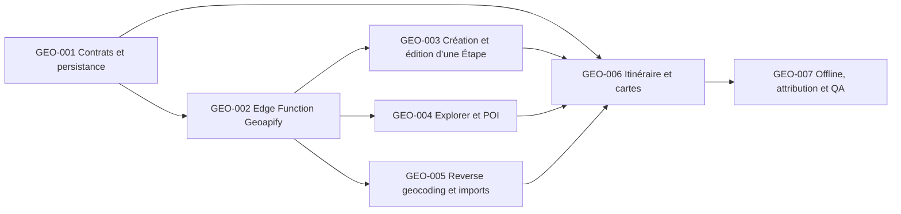

# GEO-001 à GEO-007 — Géocodage, Étapes et lieux Geoapify

Date de cadrage : 13 août 2026.

Ce lot décompose l’ancien `PLS-001` en tâches livrables. Les tâches partagent le même objectif : transformer une saisie de ville, une épingle ou des coordonnées en données géographiques confirmées et réutilisables dans Naveyo.

## Ordre d’exécution

## GEO-001 — Contrats domaine et persistance

- Priorité : P0
- Dépendances : `ARC-001`, `BCK-001`
- Possède : `src/modules/_shared/model.ts`, `src/modules/places/**`, migrations Supabase places/stops, fixtures et tests de contrat.

Livrables : localisation optionnelle d’une Étape, identifiant fournisseur, attribution, fuseau IANA, opérations `autocomplete`, `reverse`, `nearby`, `getById` et `createManual`, validation et déduplication.

Acceptation : anciennes Étapes lisibles sans coordonnées, aucune coordonnée hors limites, aucune API fournisseur exposée dans les types métier, attribution conservée.

## GEO-002 — Gateway serveur Geoapify

- Priorité : P0
- Dépendances : `GEO-001`
- Possède : `supabase/functions/places-search/**`, `src/adapters/geoapify/**`, tests Edge/Adapter.

Livrables : autocomplete de villes, forward/reverse geocoding, Places API avec rayon circulaire et catégories, Place Details, validation stricte, authentification Voyage, timeout, quota et cache court.

Acceptation : clé uniquement côté serveur, réponses externes normalisées avant usage, appels bornés/annulables, erreurs 400/408/429/5xx traduites en états applicatifs, aucun log de coordonnées personnelles.

## GEO-003 — Création et édition d’une Étape

- Priorité : P0
- Dépendances : `GEO-001`, `GEO-002`, `TRP-001`, `MOB-001`
- Possède : route et écran Nouvelle Étape, écran d’édition de l’Étape, modèle `trips` et tests UI.

Livrables : autocomplete avec debounce, sélection d’une ville, aperçu MapKit, pays/fuseau préremplis, épingle manuelle, action explicite « Utiliser ma position », confirmation avant changement de localisation.

Acceptation : le texte libre ne crée rien, permission GPS refusée reste contournable, changement de ville conserve les éléments et dates/heures locales avec nouveau fuseau, mode hors ligne lisible mais recherche désactivée.

## GEO-004 — Explorer autour d’une Étape et détail d’un lieu

- Priorité : P0
- Dépendances : `GEO-001`, `GEO-002`
- Possède : écran Explorer, route détail lieu, `trip-assistant`, catégories/rayons et tests.

Livrables : recherche POI autour des coordonnées de l’Étape, filtres bornés (catégorie/rayon), liste/carte, distance, attribution, ouverture d’un candidat et ajout humain à l’itinéraire.

Acceptation : au plus 20 candidats par requête, aucun lieu inventé par l’IA, aucun ajout automatique, résultats sans coordonnées exclus de la carte mais conservés dans la liste.

## GEO-005 — Reverse geocoding et résolution des imports

- Priorité : P0
- Dépendances : `GEO-002`, `RSV-001`, `OCR-001` si conservé
- Possède : sélecteur épingle partagé, résolution des adresses de réservation et tests d’import.

Livrables : coordonnées → adresse/ville, candidats pour lieu/départ/arrivée, choix manuel ou conservation explicite non géolocalisée, déduplication par identifiant fournisseur.

Acceptation : aucune adresse détectée n’est confirmée automatiquement, attribution visible après sauvegarde, absence de réseau ou résultat ambigu n’empêche pas la confirmation du reste de la réservation.

## GEO-006 — Itinéraire, tableau de bord et cartes

- Priorité : P0
- Dépendances : `GEO-003`, `GEO-004`, `GEO-005`, `ITN-001`
- Possède : modèles carte, écrans Étape/Tableau de bord/Itinéraire/Adresses et tests de présentation.

Livrables : position de l’Étape sur carte, marqueurs de lieux confirmés, ajout d’un arrêt par recherche/épingle, liste Adresses du Voyage, ouverture Plans/Waze, état dégradé sans tuiles.

Acceptation : aucun appel fournisseur dans les écrans, uniquement coordonnées confirmées sur la carte, cache consultable hors ligne, trace GPS jamais géocodée.

## GEO-007 — Offline, attribution, quotas et validation appareil

- Priorité : P0
- Dépendances : `GEO-001` à `GEO-006`, `OFF-001`
- Possède : TripPack, métriques et documentation de release géographique.

Livrables : migration de version TripPack, cache des lieux confirmés, attribution Geoapify/OpenStreetMap, métriques de crédits, tests quota/timeout et matrice iPhone.

Acceptation : lieux confirmés lisibles en mode avion, aucun secret dans le bundle, attributions affichées, recherche/reverse désactivés proprement hors ligne, parcours validé sur les deux iPhone.
